[linkedin](https://www.linkedin.com/in/aaron-murphy-2949551b9/) &nbsp;·&nbsp;
[email](mailto:aaronm2766@gmail.com)

> Backend engineer in Dublin, Ireland. Open to backend, platform and applied-AI roles. 
> I build systems that have to stay up, and write the runbook so nobody guesses at 3am.

Five years shipping production systems other people depend on: mostly Python, some Go, 
a lot of SQL. Outside work I build whole products end to end in TypeScript, from the 
schema and the billing to the webhooks and the LLM pipeline.

What I'm good at:

- **Making slow things fast.** The N+1, the missing index, the query that scans everything.
- **Pipelines that survive failure.** Queues, retries, idempotent webhooks, no double writes.
- **Security that survives review.** Tenant isolation, encrypted secrets, verify before parse.
- **LLM features you can trust.** Structured output, validation in code, cost metered per call.
- **Deleting more than I add.**

**[coachable](https://github.com/aaronmurphy45/coachable)** &nbsp;·&nbsp; <samp>typescript &nbsp; next.js &nbsp; postgres &nbsp; drizzle &nbsp; ai-sdk &nbsp; stripe</samp> 
Multi-tenant AI sales-coaching SaaS. It grades every call against a company's own A+ standard, 
finds the single biggest weakness, and turns it into a roleplay drill the rep runs before the next dial. 
The hard parts: tenant isolation that holds even when a record id leaks; customer API keys encrypted 
with AES-256-GCM; signed webhooks for six phone providers that verify before they parse; a 
retrying transcribe → grade worker; and cost metered in micro-USD so sub-cent calls still bill.

**[all-print](https://github.com/aaronmurphy45/all-print)** &nbsp;·&nbsp; <samp>react &nbsp; vite &nbsp; netlify functions</samp> 
Production rebuild of a Dublin print shop's site: live catalogue pricing, a quote flow, and a 
browser designer for wedding and memorial stationery. One renderer draws both the preview and the 
300 DPI print file, so what the customer arranges is exactly what gets printed. The PDF writer is 
200 lines with no dependency, and the same code runs in the browser and the serverless function.

**[ai-code-reviewer](https://github.com/aaronmurphy45/ai-code-reviewer)** &nbsp;·&nbsp; <samp>python &nbsp; fastapi &nbsp; openai &nbsp; github api</samp> 
Reviews a file, a diff or a live pull request and returns structured findings with severity and 
confidence. A finding that can't name a concrete failure scenario gets dropped, and that one rule 
removes most of the noise these tools usually produce.

**[ai-clip-cutter](https://github.com/aaronmurphy45/ai-clip-cutter)** &nbsp;·&nbsp; <samp>python &nbsp; whisper &nbsp; ffmpeg</samp> 
Long video in, vertical clips out, with word-by-word burned-in captions and an on-screen hook. 
Model timings are treated as suggestions: each clip is snapped to real word boundaries, clamped, 
and de-overlapped in code, so no clip opens halfway through a syllable.

<samp>python &nbsp; go &nbsp; typescript &nbsp; sql &nbsp; postgres &nbsp; redis &nbsp; celery &nbsp; airflow &nbsp; fastapi &nbsp; next.js &nbsp; react &nbsp; docker &nbsp; azure &nbsp; linux &nbsp; git</samp>

No badge services. Every graphic here is an SVG built in this repo and redrawn by 
[a nightly action](.github/workflows/stats.yml) from the GitHub GraphQL API, which commits only 
the files whose bytes changed. Language figures count public repositories only.
